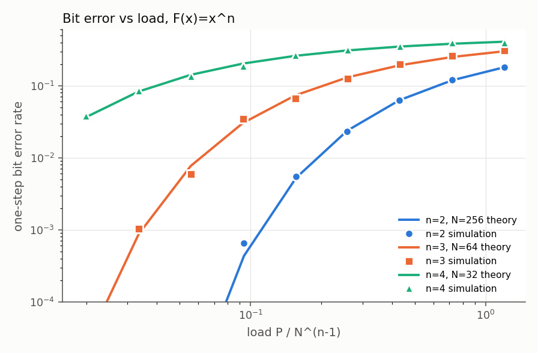
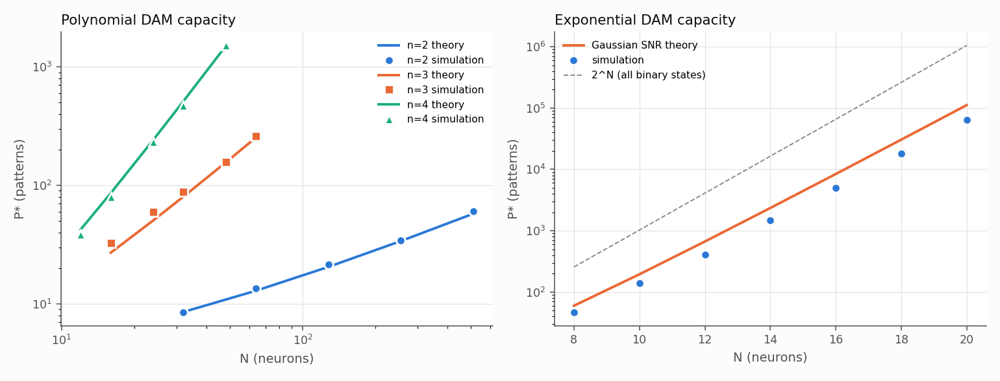
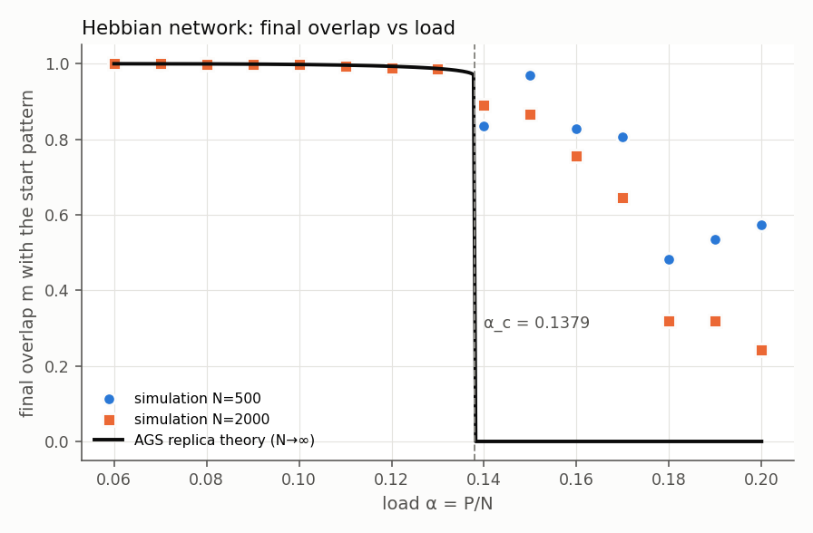
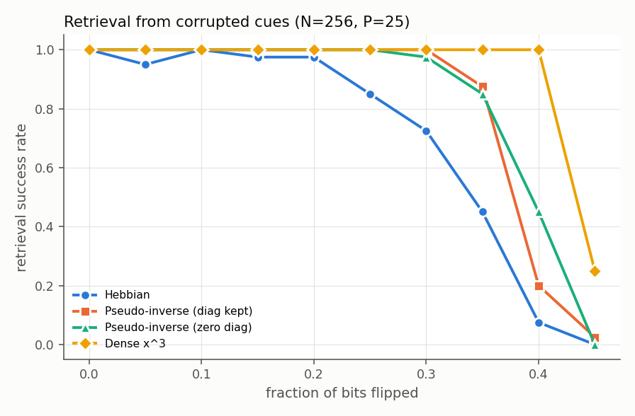
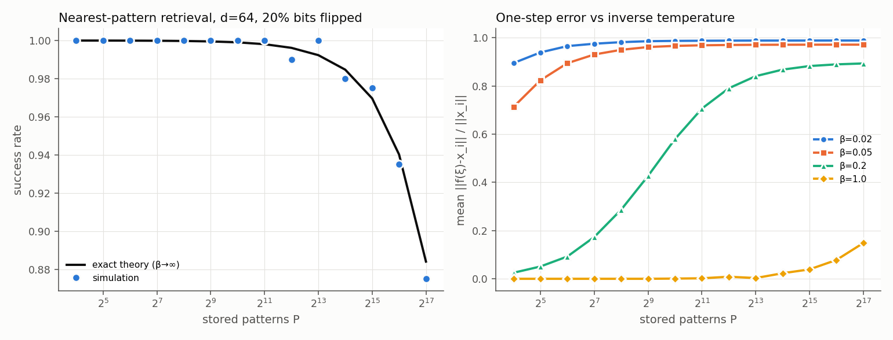

# dense-associative-memory

How many memories can an attractor network store, and what does that capacity cost?
This repository implements four families of Hopfield-style associative memory
from scratch in NumPy:

- classical pairwise networks, with Hebbian, Storkey, and pseudo-inverse learning rules
- polynomial dense associative memories, with F(x)=x^n
- exponential dense associative memories, with F(x)=e^x
- the continuous "modern" Hopfield network, whose update is one head of softmax attention

Each simulation is checked against an analytical baseline:

- a crosstalk signal-to-noise theory with exact binomial moments
- the Amit–Gutfreund–Sompolinsky (AGS) replica solution for the Hebbian transition
- an exact nearest-neighbour law for β → ∞ retrieval
- a worst-case retrieval bound for the softmax update

All results come from simulations on synthetic random ±1 patterns or from
closed-form theory, and each table labels which is which. None of them are
hardware measurements.

## Why this is interesting

Attractor networks are the classic model of content-addressable memory in cortex
and hippocampus (for example, CA3 pattern completion). A pairwise network with N
neurons stores only about 0.14 N random patterns. Krotov and Hopfield (2016)
showed that higher-order interactions raise this to about N^(n-1). Demircigil et
al. (2017) made it exponential, and Ramsauer et al. (2020) showed that the
continuous exponential version is the attention mechanism. This lab separates
three kinds of claim along that line:

1. what the theory predicts exactly,
2. what finite-N simulation shows,
3. what the higher capacity costs in parameters and compute.

## Headline findings

| # | Result |
|---|---|
| E1 | The Gaussian crosstalk theory predicts one-step bit error rates for x², x³, and x⁴ within Monte Carlo noise across a 60× load range (e.g. x³, N=64, P=1059: sim 0.124, theory 0.131). |
| E2 | Measured error-free capacity P* agrees with theory to within 0.91–1.20× for every (n, N). Log-log slopes are 0.70, 1.48, and 2.64 for n=2, 3, 4, below the asymptotic exponents 1, 2, 3 because of the 1/ln N factor. The theory slopes (0.69, 1.61, 2.57) show the same shortfall. |
| E2 | Exponential F: at N=20, **64,306 patterns** are fully stable (6.1% of all 2^20 binary states), against a Gaussian SNR prediction of 112k. The fitted growth is 2^(0.874 N) vs 2^(0.908 N) predicted. The overshoot comes from the heavy-tailed e^h crosstalk, which the Gaussian approximation underweights. |
| E3 | Correlated patterns (bias a=0.6) collapse Hebbian capacity from 0.168 N to 0.027 N and Storkey from 0.512 N to 0.105 N. The pseudo-inverse stores every P < N at every bias. |
| E4 | The computed AGS α_c = 0.13791 and m(α_c⁻) = 0.968 match the literature values. Simulation tracks the retrieval branch up to α=0.13. Above α_c, finite-N networks keep partial overlap, and the drop sharpens from N=500 to N=2000 (m at α=0.18: 0.48 → 0.32). |
| E5 | At load 0.1 (N=256, P=25), a cubic dense memory retrieves 100% of cues with 40% of bits flipped. Hebbian retrieves 7% and the pseudo-inverse 20–45%. |
| E6 | Softmax retrieval (d=64, 20% corruption) matches the exact β→∞ nearest-neighbour law out to P = 2^17 = 131,072 patterns (sim 0.875, theory 0.884). The theoretical 50%-success load grows like 2^(≈0.3 d). |
| E6 | The worst-case retrieval bound (Ramsauer-style) was never violated, but it is informative only for 0–1 flipped bits out of 64. It says nothing in the regime where retrieval actually works. |
| E7 | Superlinear capacity is paid for in parameters. At N=64, x⁴ (theory P*) stores 2.1e5 bits using either 2.1e5 pattern entries or 6.4e5 tensor entries, which is ≤ 1 bit per parameter either way. Update cost grows linearly in P. |

The full output is in [`results/results.md`](results/results.md).

## Figures

| | |
|---|---|
|  |  |
|  |  |



## Technical design

### Models (`dam/`)

| module | contents |
|---|---|
| `classical.py` | Hebbian, Storkey (diagonal zeroed each step), and pseudo-inverse (diagonal optional) rules. Asynchronous dynamics with an incrementally maintained local field (O(N) per flip), and synchronous dynamics with 2-cycle detection. |
| `dense.py` | `DenseAM` in pattern ("hidden unit") form. Bit i is updated by comparing Σ_μ F(h_μ + ξ_μi) against Σ_μ F(h_μ − ξ_μi), where h_μ is the overlap with bit i removed. For x^n the difference is expanded binomially, 2ξ Σ_{k odd} C(n,k) h^(n−k), so there is no cancellation of huge powers. For e^x it is a log-sum-exp difference, so it never overflows. |
| `modern.py` | The continuous update `X^T softmax(β X ξ)`, its energy (−lse + ½‖ξ‖², a CCCP descent), and the retrieval bound. |
| `theory.py` | Exact crosstalk moments, bit error rate, closed-form capacity, and the AGS T=0 solution. |
| `patterns.py` | Biased ±1 patterns and exact-count bit corruption. |

### The crosstalk theory

When the network is probed with stored pattern ξ¹, the drive on bit i toward its
correct value splits into a signal S = F(N) − F(N−2) and a crosstalk term:

```
crosstalk = Σ_{μ≠1} ε_μ g(h_μ),    g(h) = F(h+1) − F(h−1),    h_μ = Σ_{j≠i} ξ^μ_j ξ^1_j
```

Here ε_μ is an independent random sign and h_μ is a sum of N−1 iid ±1 values.
`theory.py` computes V = E[g(h)²] exactly from the binomial law instead of the
large-N approximation 4n²(2n−3)!! N^(n−1). The CLT then gives
p_err = Φ(−S/√((P−1)V)). Assuming bit errors are independent, the load at
which half of the stored patterns are fully stable has the closed form
P* = 1 + S²/(V z²), where z = Φ⁻¹(1 − 2^(−1/N)).

For x², this reduces to the textbook Φ(−√((N−1)/(P−1))).

### The exact softmax-retrieval law

A query ξ is a stored pattern with k bits flipped. Every other random pattern
has overlap 2B − d with ξ, where B ~ Binomial(d, ½), and these overlaps are
independent across patterns. The true pattern scores exactly d − 2k. The
probability that softmax attention at β → ∞ picks the right pattern is
therefore Pr(B < d − k)^(P−1). No approximation is involved.

### The retrieval bound (derived in `modern.py`)

The bound uses M = max ‖x_j‖ and the separation Δ_i = x_iᵀx_i − max_{j≠i} x_iᵀx_j:

```
1 − p_i ≤ (P−1) exp(−β(Δ_i − 2M‖ξ−x_i‖)) = ε,     ‖f(ξ) − x_i‖ ≤ 2Mε
```

It is tight only when the corruption is tiny compared with Δ_i/2M. E6 measures
how quickly it becomes vacuous.

## Installation

```bash
pip install -r requirements.txt     # numpy, scipy, matplotlib
```

Tested with Python 3.13, NumPy 2.3, SciPy 1.17, and Matplotlib 3.10.

## Usage

```bash
python3 -m experiments.run_all            # full suite, ~2 min on a laptop
python3 -m experiments.run_all --quick    # smaller grids, ~7 s
python3 -m unittest discover -s tests     # 19 tests, <1 s
```

The full run writes `results/results.md` and `figures/*.png`. The quick run
writes `results/results_quick.md`. Everything is seeded (`--seed`, default 7).

Library use:

```python
import numpy as np
from dam.dense import DenseAM
from dam.patterns import random_patterns, corrupt, overlap

rng = np.random.default_rng(0)
X = random_patterns(rng, P=60, N=100)          # load 0.6 — hopeless for a pairwise net
am = DenseAM(X, kind="poly", n=3)
s, sweeps, converged = am.run_async(corrupt(rng, X[0], 0.2)[0], rng)
print(overlap(s, X[0]))                        # 1.0
```

## Tests

`tests/test_memories.py` checks correctness rather than smoke:

- **Independent-implementation equivalence.** Hebbian W-form and x² pattern
  form produce identical stability masks and identical async trajectories. The
  incremental drive equals naive two-point energy evaluation for x³, x⁴, x⁵, and e^x.
- **Lyapunov functions.** Every asynchronous flip lowers the energy for all four
  pairwise rules (at bias 0.3) and for x³, x⁴, and e^x. The continuous modern
  energy never increases under the update at β ∈ {0.1, 1, 8}.
- **Exact fixed points.** The pseudo-inverse stores 90 correlated patterns
  at N=100 with and without the diagonal.
- **Theory.** Binomial crosstalk moments match brute-force enumeration over
  all 2^(N−1) sign patterns. The x² case matches the textbook erfc formula to
  12 digits. The bit error rate matches simulation within 5 standard errors.
  α_c and m(α_c⁻) match literature constants.
- **Modern network.** The update equals softmax attention (single and batched
  queries). The retrieval bound holds on 300 random instances. β → 0 converges
  to the metastable mean state, and β = 1 retrieves exactly.
- A synchronous 2-cycle exists, which is why the dynamics are asynchronous.

## Limitations and assumptions

- **Random unbiased patterns** throughout, except in E3. Real memories are
  correlated, and every capacity law here depends on the independence assumption.
- **Capacity criterion.** P* is the load at which 50% of stored patterns are
  exact fixed points. That criterion is stricter than AGS's (which tolerates
  ~1.6% bit errors), so the Hebbian P*/N values (0.27 at N=32 falling to 0.12 at N=512, as N/(2 ln N) predicts) are not directly
  comparable to 0.138.
- **Independence of bit errors** is an assumption in the closed-form P*. Its
  accuracy (0.91–1.20×) is measured rather than assumed.
- **Finite N.** The x⁴ and e^x grids stop at N=48 and N=20. Beyond that, one
  capacity search costs minutes to hours in NumPy. P* values carry
  Monte Carlo noise of a few percent (256 probes per bisection step).
- **AGS comparison.** The final overlap above α_c depends on N and on the
  dynamics. The replica theory only says the retrieval branch vanishes. The
  E4 simulations use 6 trials per point and are visibly noisy there.
- **No learning of continuous weights** and no training. The modern network
  uses fixed ±1 patterns as keys and values, not learned projections.

## Project structure

```
dam/            models and theory (library)
experiments/    E1–E7; run_all.py orchestrates and writes the report
tests/          unittest suite
results/        results.md (full run output)
figures/        generated PNGs
```

## References

- J. J. Hopfield, *Neural networks and physical systems with emergent collective computational abilities*, PNAS 1982.
- D. J. Amit, H. Gutfreund, H. Sompolinsky, *Storing infinite numbers of patterns in a spin-glass model of neural networks*, PRL 1985.
- A. Storkey, *Increasing the capacity of a Hopfield network without sacrificing functionality*, ICANN 1997.
- D. Krotov, J. J. Hopfield, *Dense associative memory for pattern recognition*, NeurIPS 2016.
- M. Demircigil et al., *On a model of associative memory with huge storage capacity*, J. Stat. Phys. 2017.
- H. Ramsauer et al., *Hopfield networks is all you need*, ICLR 2021.
